# ForgeLab 3D

**A premium 3D product configurator with real part swapping, mobile AR and a Shopify checkout.**
Build a custom road bike in seven guided steps: every choice changes the 3D model, the price updates
live, compatibility rules prevent impossible builds, and the finished build checks out in a real
Shopify store.

**[▶ Live demo](https://relaxed-custard-cb3af1.netlify.app/)** ·
**[How it's built](https://relaxed-custard-cb3af1.netlify.app/how-its-built)** ·
[Docs](#documentation)

> Independent portfolio / technology demonstration. ForgeLab is a fictional brand; the bike is an
> original procedurally generated model, and all product names, specs, prices and rules are
> illustrative. See [Disclaimers](#disclaimers).

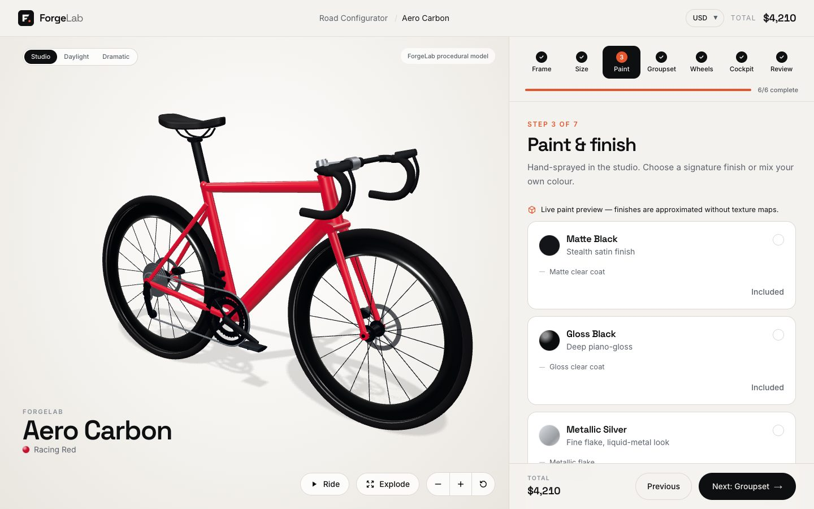

---

## Contents

- [Try it in 2 minutes](#try-it-in-2-minutes)
- [Highlights](#highlights)
- [Features in detail](#features-in-detail)
- [Studio admin: one-of-a-kind pieces](#studio-admin-one-of-a-kind-pieces)
- [How checkout stays trustworthy](#how-checkout-stays-trustworthy)
- [Tech stack](#tech-stack)
- [Run locally](#run-locally)
- [Configuration (environment variables)](#configuration-environment-variables)
- [Project structure](#project-structure)
- [Quality](#quality)
- [Documentation](#documentation)
- [Known limits](#known-limits)
- [Built with Claude Code](#built-with-claude-code)
- [Disclaimers](#disclaimers)

## Try it in 2 minutes

1. Open the **[live demo](https://relaxed-custard-cb3af1.netlify.app/)** and drag the bike to orbit it.
2. **Frame → Endurance → Steel**: the frame geometry changes; wheels, bar and saddle stay mounted.
3. **Paint → Forged Pattern**, then zoom in: a procedural GPU finish with no textures.
4. In the viewer press **Ride** (authored animation) and **Explode** (animated exploded assembly).
5. **Cockpit → Carbon Aero bar**: a compatibility rule fires with one-click fixes. Further down,
   **One-of-a-kind cover** shows a studio-uploaded photo mapped onto the 3D saddle.
6. **Review → Add to cart**, ship to Texas: Shopify prices the build, then
   **Continue to checkout** opens the real Shopify checkout. It's a test store: the cart shows the
   storefront password, you're brought back to ForgeLab after entering it, and a banner continues
   your checkout. No real payment is taken.
7. On a phone, tap **AR** to place the exact build in your room at 1:1.

## Highlights

| | |
|---|---|
| 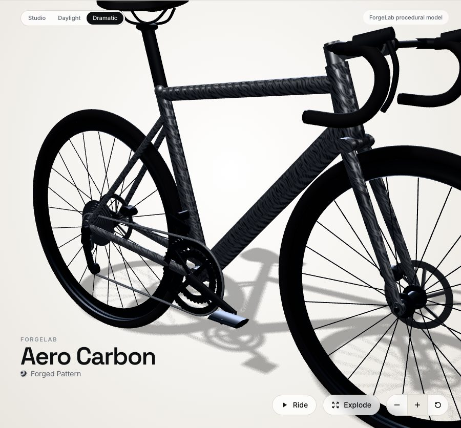 | 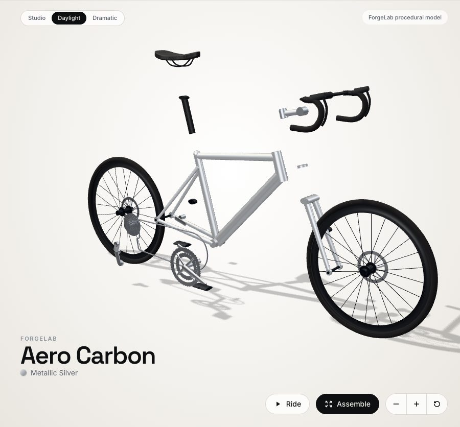 |
| **Procedural "Forged Pattern" shader**: anti-aliased GPU material, 0 KB of textures, plus lighting presets | **Exploded assembly view**: animated, and parts can still be swapped while exploded |
| 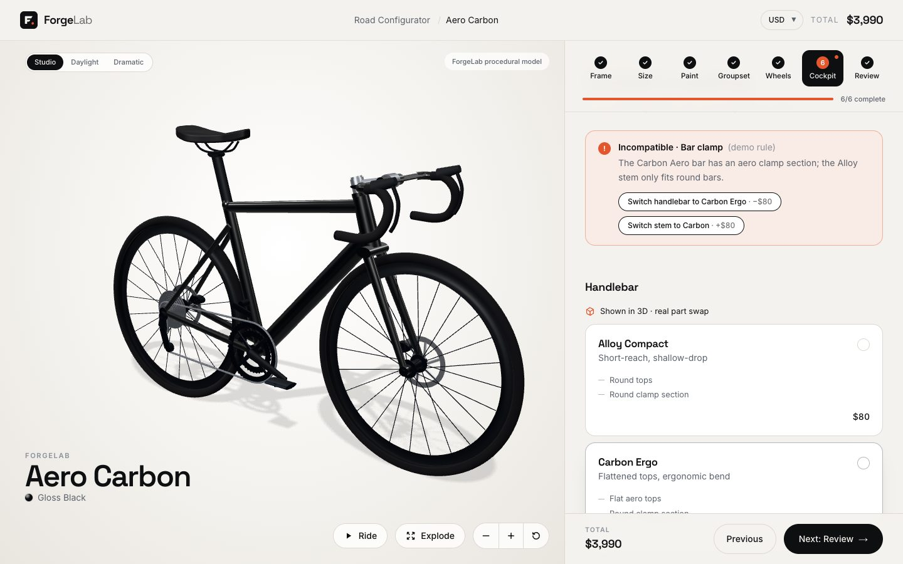 | 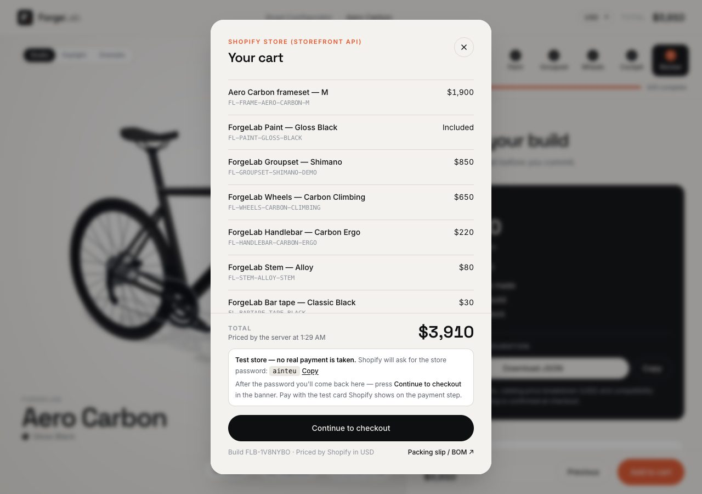 |
| **Compatibility rules** that explain the conflict and offer fixes that never create new ones | **Cart priced by Shopify** (Storefront API); the browser never sends prices |
| 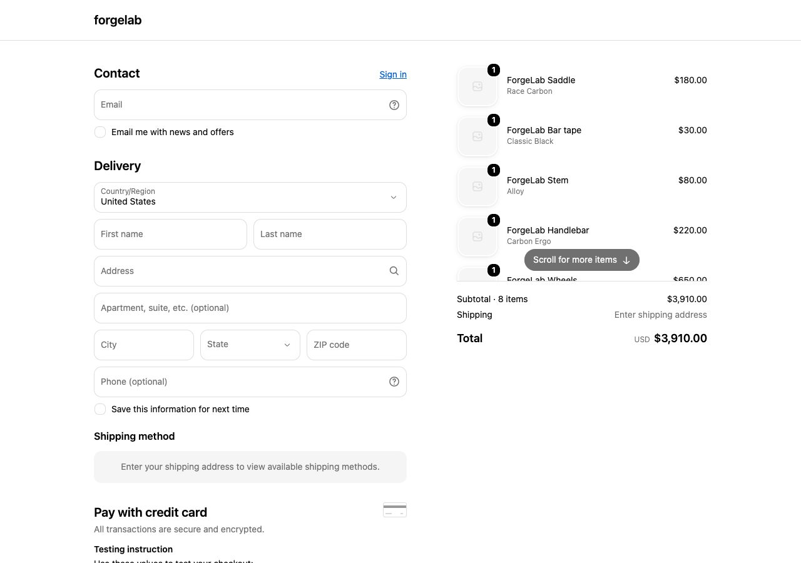 | 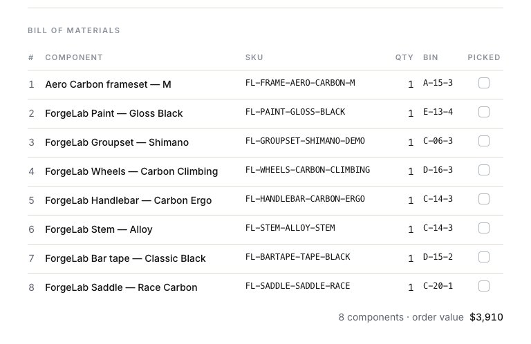 |
| **Shopify-hosted checkout** with every component of the build | **Packing slip / bill of materials** generated from the server-priced cart |

<p align="center">
  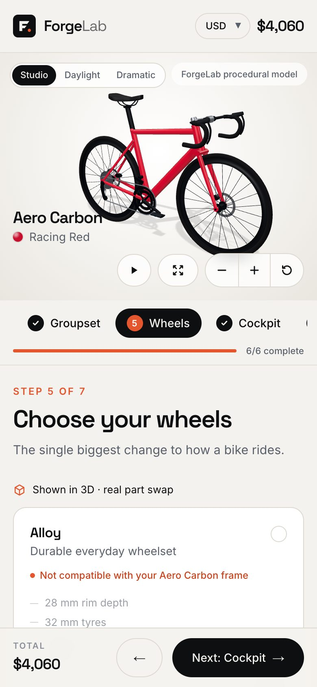
  &nbsp;&nbsp;
  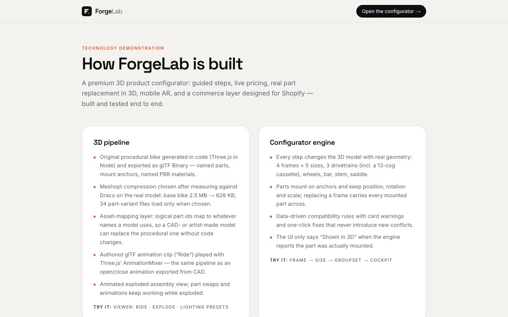
</p>
<p align="center"><em>Mobile: the bike stays visible while you choose · the "How it's built" case-study page</em></p>

## Features in detail

### 3D viewer and asset pipeline
- **Three.js** viewer: orbit, zoom, reset, loading progress, error states, lighting presets
  (studio / daylight / dramatic), full disposal of GPU resources on unmount.
- **Every step changes the 3D model with real geometry**: 4 framesets × 5 sizes (frame geometry, bar
  and saddle height), 3 demo groupsets (crankset, cassette incl. a 13-cog option, chain,
  derailleurs), wheels, handlebar, stem, saddle, paint and bar tape.
- **Parts mount on anchors** (`anchor_*` nodes): swaps keep position, rotation and scale; swapping
  the frame carries every mounted part across.
- **Asset-mapping layer**: logical ids (`frame_main`, `wheel_front`, …) map to whatever node and
  material names a model uses, so a CAD- or artist-made model can replace the procedural one
  without code changes. Missing parts are reported, never faked.
- **Authored glTF animation** ("Ride": cranks turn, wheels spin) played with `AnimationMixer`; it
  re-binds automatically after part swaps.
- **Original procedural model**, generated in code (`scripts/bike/`) and exported as glTF Binary.
  **Meshopt** compression was chosen after measuring it against Draco on the real model: the base bike
  goes from 2.5 MB to **628 KB**, and 34 part-variant files load only when chosen
  ([performance notes](docs/performance.md)).

### Materials
- Real-time **PBR paint**: matte / gloss / metallic with clearcoat, preset or custom colour, animated,
  with no scene reload.
- **Forged Pattern**: a procedural shader injected with `onBeforeCompile`, anti-aliased with `fwidth`
  so fine bands don't shimmer at a distance.
- **One-of-a-kind pieces**: the studio uploads a photo in `/admin`; it becomes a selectable option and
  is projected onto the 3D saddle (planar UV mapping), so buyers see the exact piece.

### Configurator
- Seven guided steps (Frame → Size → Paint → Groupset → Wheels → Cockpit → Review) with completion
  states and required-selection validation.
- **Fictional, data-driven compatibility rules** (tyre clearance, drivetrain speeds, bar clamp,
  advisory saddle fit, auto-matched bottom bracket) with card warnings and one-click fixes.
- Live price with per-component breakdown; **currency switcher** (USD / CAD / EUR / GBP / JPY).
- **Stock per component** (frame stock per size) with low-stock and sold-out states.
- Build saved in a cookie (rendered server-side, survives reloads); JSON export
  (`forgelab.configuration/v1`).
- Accessible: radio-group option cards, keyboard operation, visible focus, live regions.
- Responsive: sticky full-height viewer on desktop, compacting sticky viewer on mobile.

### Mobile AR at real size
- **iPhone**: the current build is exported to **USDZ in the browser** and opened in AR Quick Look.
- **Android**: live **WebXR** placement first, with **Google Scene Viewer** as a fallback, fed by a GLB
  of the exact build assembled on the server (`/api/ar/model.glb`).
- Tested on a Galaxy S24 Ultra. Phones without ARCore can't run AR, and the page says so.

### Commerce and Shopify
- The configurator talks only to `CommerceProvider` interfaces (catalog, cart, checkout). A **mock
  store** and a **Shopify Storefront API** provider plug into the same flow.
- **Shopify mode** (`NUXT_PUBLIC_COMMERCE_PROVIDER=shopify`, used by the live demo):
  - **prices and stock shown in the configurator come live from Shopify** (cards, totals, stock
    badges; cached for a minute), so the store owner changes them in Shopify admin, not in code;
  - every cart line is priced from Shopify by SKU and market (`@inContext`);
  - sold-out variants are refused;
  - the cart is created with `cartCreate` (build id and options as line attributes);
  - checkout is Shopify-hosted.
- **Product catalog generated from the configurator**: `npm run shopify:csv` writes a Shopify product
  import with the same SKUs, prices and stock.
- **Region shipping rules** enforced before checkout (e.g. a finish that can't ship to some states),
  with "change finish / change destination" actions.
- **Printable packing slip** with bill of materials, bin locations and an assembly checklist.
- **Return from Shopify**: the store's theme sends its pages (and "Continue shopping" after an order)
  back to the configurator; if a checkout is still open, a one-time banner resumes it.
- No Shopify SDK: one typed `fetch`, so the bundle doesn't grow.

<p align="center">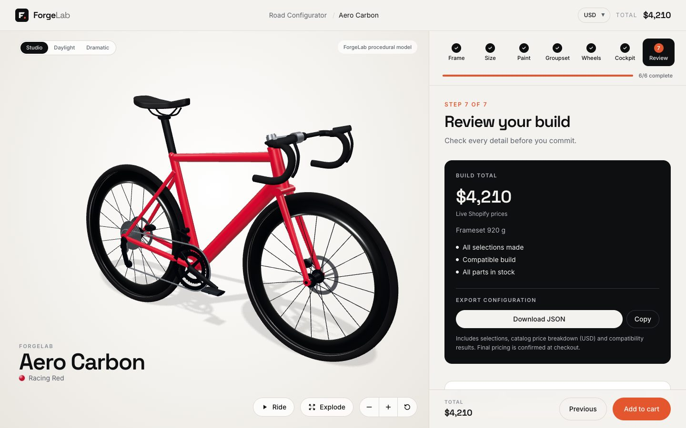<br><sub>Prices and stock come live from the Shopify store: change them in Shopify admin and the configurator follows within a minute.</sub></p>

## Studio admin: one-of-a-kind pieces

For products where every piece is unique (a hide, a burl, a hand-finished part), the studio
photographs the piece and publishes it in **`/admin`**. Buyers then choose that exact piece in the
configurator, see the photo mapped onto the 3D part, and buy it as an inventory-of-one item.

| | |
|---|---|
| 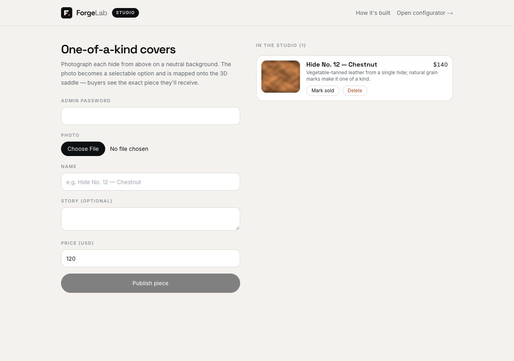 | 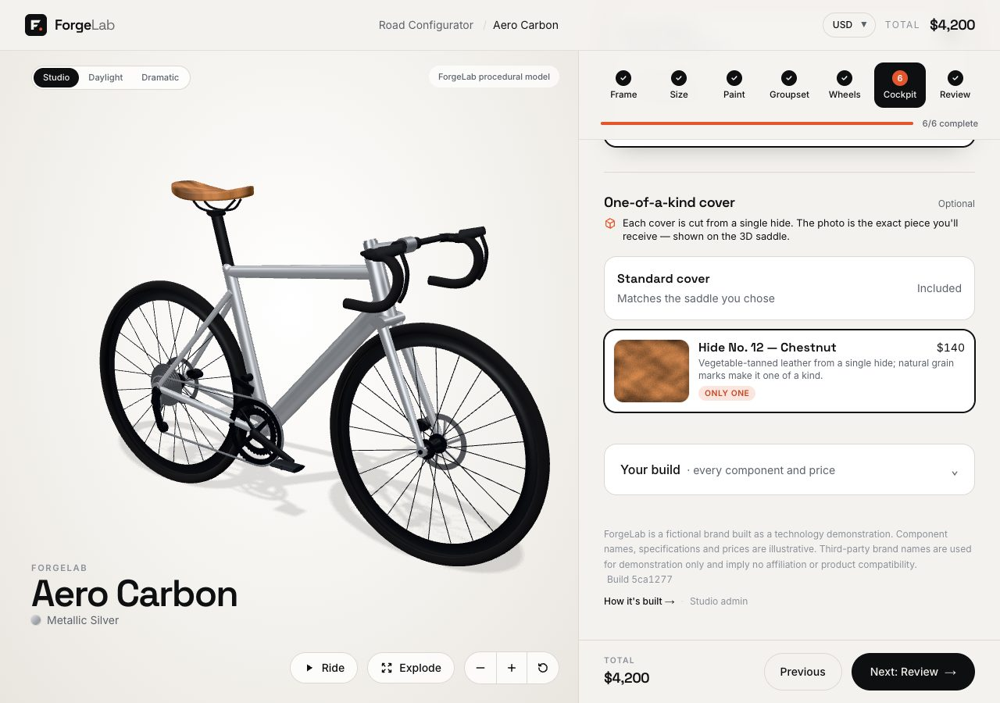 |
| **`/admin`**: password-protected upload, *Mark sold*, *Delete* | **Cockpit step**: the piece's photo, story and price; *Only one* / *Sold* states |

<p align="center">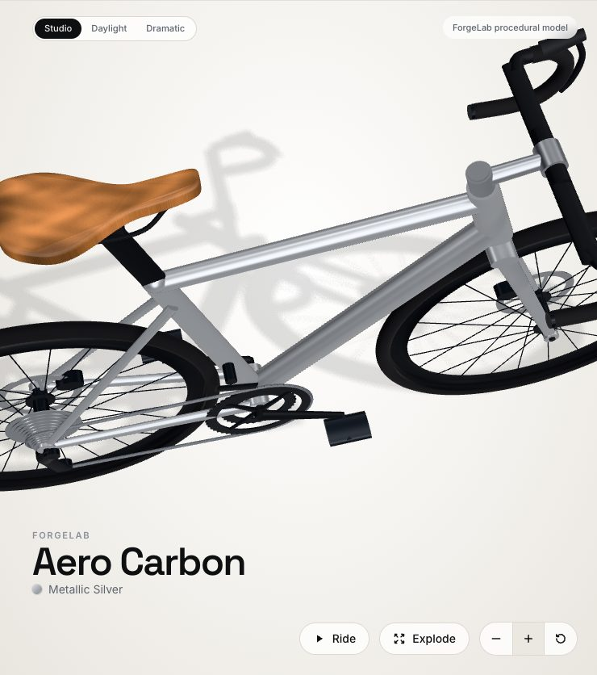</p>
<p align="center"><em>The uploaded photo is projected onto the saddle in 3D (planar UV mapping), so the buyer sees the exact piece.</em></p>

How it works:
- **Upload**: the photo is resized in the browser (max 1,200 px JPEG, which also drops EXIF/location
  data) and sent with name, story and price. The server checks the password
  (`NUXT_ADMIN_PASSWORD`), validates the fields, and checks the **file bytes** (JPEG/PNG/WebP
  signatures, not the file name); max 1.5 MB, max 24 pieces.
- **Storage**: Netlify Blobs in production (strongly consistent, so a change is visible on the next
  request), a local `.data/` folder in development.
- **Selling**: the server prices the piece from its own record, adds it as a separate cart line, and
  refuses it once it's marked sold, so the same piece can't be sold twice.
- **3D**: the photo is loaded as a texture and mapped onto the saddle-cover surface; it stays applied
  when the saddle model is swapped, and the original cover is restored when the buyer picks
  *Standard cover*.
- In Shopify mode, pieces can be chosen and shown, but checkout refuses them until they are synced to
  Shopify (see [Known limits](#known-limits)).

## How checkout stays trustworthy

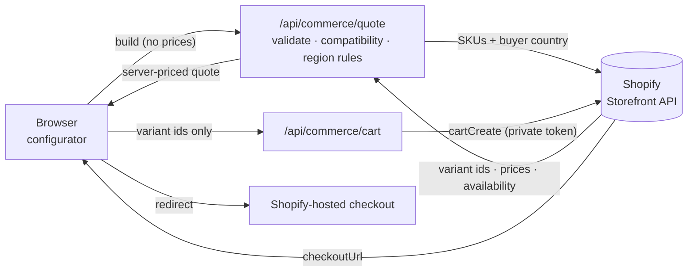

- The browser sends **choices, never prices**. Unknown or tampered option ids are rejected.
- Incompatible, incomplete, sold-out or non-shippable builds never reach a cart.
- The **private Storefront token lives only on the server**. Shopify recommends this for server
  requests, and the buyer's IP is forwarded.
- Prices shown while configuring are estimates; Shopify's price is final, and the cart says so when
  they differ (e.g. another currency).

## Tech stack

| Area | Choice |
|---|---|
| App | Nuxt 3 (Vue 3 `<script setup>`, TypeScript strict), Nitro server routes, SSR |
| 3D | Three.js r187: GLTFLoader + Meshopt, PBR materials, custom shader, AnimationMixer, WebXR, USDZ/GLTF exporters |
| Styling | Tailwind CSS with brand tokens, `@nuxt/fonts` (Inter, Space Grotesk) |
| Commerce | Shopify Storefront API (GraphQL, `2026-10`), mock provider for offline/demo |
| Storage | Netlify Blobs (uploaded pieces) via Nitro storage; local `.data/` in development |
| Hosting | Netlify (SSR functions) |
| Tests | Vitest (unit tests against the real model files), Playwright (end-to-end checks) |

## Run locally

Requires **Node 20+** (22 recommended).

```bash
npm install
npm run dev            # http://localhost:3000 (mock store, no setup needed)

npm test               # Vitest
npm run typecheck      # app + server + Node scripts
npm run build && npm run preview

npm run generate:bike  # regenerate the procedural GLBs
npm run inspect:glb -- public/models/bicycle/road-bike.glb
npm run shopify:csv    # Shopify product import → shopify/forgelab-products.csv
```

## Configuration (environment variables)

Everything is optional; without variables the app runs on the mock store. Put local values in
`.env` (git-ignored) and production values in your host's environment settings.

| Variable | Purpose |
|---|---|
| `NUXT_PUBLIC_COMMERCE_PROVIDER` | `mock` (default) or `shopify` |
| `NUXT_PUBLIC_SHOPIFY_STORE_DOMAIN` | `your-store.myshopify.com` |
| `NUXT_SHOPIFY_STOREFRONT_PRIVATE_TOKEN` | Private Storefront token from the Headless channel (**server-only, secret**) |
| `NUXT_PUBLIC_SHOPIFY_STORE_PASSWORD` | Dev stores only: shows a "test store" note with the storefront password in the cart |
| `NUXT_ADMIN_PASSWORD` | Enables `/admin` uploads of one-of-a-kind pieces |

Shopify store setup (dev store, Headless channel, CSV import, markets, shipping) is covered step by
step in **[docs/shopify-integration.md](docs/shopify-integration.md)**.

## Project structure

```
app/
  pages/            index (configurator), how-its-built, packing-slip, admin
  components/       builder/ (steps, options, cart, review), viewer/ProductViewer.vue
  composables/      configurator state, steps, pricing, compatibility, currency, inventory, commerce
  config/           ALL catalog data: options, prices, compatibility rules, stock, shipping, currencies
  commerce/         CommerceProvider types, mock store, Shopify provider + service, CSV generator
  utils/three/      scene, loading, asset mapping, swap engine, exploded view, ride, AR, shaders
server/api/         commerce (quote, cart), AR model assembly, unique pieces (+ admin)
scripts/            procedural bike generator, GLB inspector, Shopify CSV
tests/              Vitest suites
docs/               architecture, guides, Shopify, assets, performance, deployment, screenshots
```

## Quality

- **TypeScript strict** across the app, server and Node scripts (`npm run typecheck`: 0 errors).
- **96 unit tests** (Vitest). The swap engine, animation, AR exports and unique-piece mapping run against
  the **real generated GLB files**, and commerce rules run against a fake Storefront API.
- **End-to-end checks** (Playwright) on desktop and phone sizes, run against production builds and the
  live site: through to Shopify checkout and back, and admin upload → 3D cover → cart → sold.
- Honest UI: "Shown in 3D" appears only when the engine reports the part was actually mounted.

## Documentation

| Doc | |
|---|---|
| [architecture](docs/architecture.md) | Layers, data flow, future backend |
| [configurator-guide](docs/configurator-guide.md) | Using/extending the configurator + 5-minute demo script |
| [shopify-integration](docs/shopify-integration.md) | Shopify setup, Storefront API provider, known limits |
| [asset-requirements](docs/asset-requirements.md) | 3D asset contract: axes, anchors, component and material names |
| [blender-workflow](docs/blender-workflow.md) | Preparing or replacing models in Blender |
| [performance](docs/performance.md) | Draco vs Meshopt evaluation and loading strategy |
| [deployment](docs/deployment.md) | Hosting, environment variables, pre-share checklist |

Project rules for contributors and AI assistants: [`CLAUDE.md`](./CLAUDE.md) (see [Built with Claude Code](#built-with-claude-code)).

## Known limits

- One-of-a-kind covers live in ForgeLab storage, not in Shopify, so they can't be bought in Shopify
  mode (a clear message explains this). The next step would be Admin API sync: a product per piece,
  with inventory of 1.
- Region rules are checked before the cart is created; enforcing them inside Shopify checkout needs a
  cart and checkout validation Function.
- The test store prices in USD only: other display currencies show Shopify's USD price converted at
  fixed demo rates (labelled as such); Shopify charges USD.
- The live demo uses a Shopify **development store**: checkout needs the storefront password shown
  in the cart, and payments are test-only.

## Built with Claude Code

This project was built with **[Claude Code](https://claude.com/claude-code)**, Anthropic's agentic
coding tool, as an AI pair programmer:

- **The author** set the goals and priorities, made the product and architecture decisions (for
  example the original procedural model, WebXR-first Android AR, a headless Shopify checkout), set
  up the Shopify store and the Netlify hosting, and tested on real devices.
- **Claude Code** wrote most of the code, tests and documentation under that direction, ran the
  type checks and test suites, and verified each feature in the running app, on production builds
  and on the live site (Playwright), including a test order through Shopify checkout.

Project rules the assistant follows, such as no fake 3D, server-side pricing and asset-mapping
conventions, are in [`CLAUDE.md`](./CLAUDE.md).

## Disclaimers

ForgeLab is a fictional brand. The bike is an original, procedurally generated model (not scanned
or artist-made). Component names, specs, prices, compatibility and shipping rules are illustrative.
Third-party brand names label demo options only and imply no affiliation or real compatibility.
